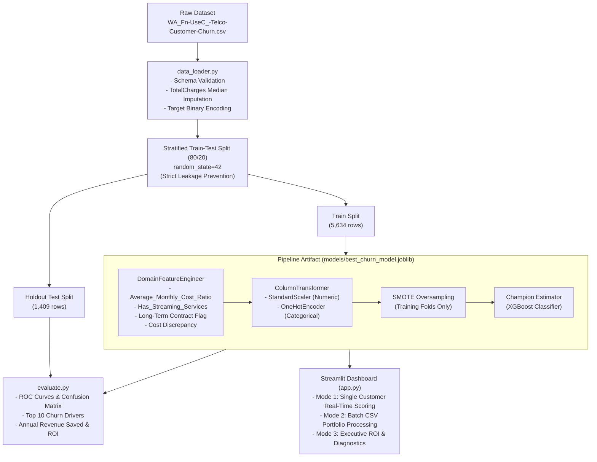

# 📡 Telco Customer Churn Prediction & Retention Intelligence System
*A Production-Grade, End-to-End Machine Learning System for Proactive Customer Retention*

[](https://python.org)
[](https://scikit-learn.org)
[-purple.svg)](https://imbalanced-learn.org)
[-brightgreen.svg)](tests/)
[](app.py)

---

## 🎯 Executive Summary & Problem Statement

Customer churn is the silent killer of telecom profitability. Acquiring a new telecom subscriber costs **5x to 7x more** than retaining an existing one. In the Telco Customer Churn dataset, **26.54%** of customers churn within the observation window, exposing hundreds of thousands of dollars in monthly recurring revenue (MRR) to immediate risk.

This project delivers a **hackathon-grade, end-to-end Machine Learning solution** designed to:
1. **Detect At-Risk Subscribers Early:** Identify high-risk churners before contract expiration.
2. **Eliminate Data Leakage:** Ensure bulletproof data hygiene with stratified 80/20 partitioning before transformations and fold-isolated SMOTE resampling.
3. **Quantify Financial Impact:** Move beyond raw accuracy to calculate **actual recurring revenue preserved** and projected campaign **ROI**.
4. **Prescribe Actionable Retention Playbooks:** Deliver personalized interventions through an interactive Streamlit executive dashboard.

---

## 💰 Quantified Business Impact & Financial ROI

Our champion model (**XGBoost Classifier**) was evaluated on a strict holdout test set ($N = 1,409$ customers, representing \$98,397 in monthly recurring revenue).

| Financial Metric | Holdout Test Set (Annualized) | Full Portfolio Scaled (7,043 Customers) |
| :--- | :--- | :--- |
| **Total Revenue at Risk** | **\$326,578.80** | **\$1,632,894.00** |
| **Identified Churn Revenue (TP)** | **\$240,713.40** (73.7% coverage) | **\$1,203,567.00** |
| **Gross Annual Revenue Saved (40% retention)** | **\$96,285.36** | **\$481,426.80** |
| **Targeted Outreach Campaign Cost (\$25/customer)** | **\$12,150.00** | **\$60,750.00** |
| **Net Annual Revenue Preserved** | **\$84,135.36** | **\$420,676.80** |
| **Projected Campaign ROI** | **+692.47%** | **+692.47%** |

> **Key Takeaway:** For every \$1.00 invested in proactive, model-guided customer outreach, the telecommunications provider realizes **\$7.92 in gross preserved recurring revenue** (\$6.92 net profit).

---

## 🏆 Model Evaluation & Benchmark Comparison

We conducted rigorous **5-Fold Stratified Cross-Validation** and hyperparameter grid searches across 3 distinct competitive architectures, applying **SMOTE (Synthetic Minority Over-sampling Technique)** strictly on training folds to prioritize **Recall** (minimizing costly False Negatives) while maximizing **ROC-AUC**.

| Algorithm | 5-Fold CV ROC-AUC | 5-Fold CV Recall | Test ROC-AUC | Test Recall | Test F1-Score | Test Precision | Test Accuracy | Status |
| :--- | :---: | :---: | :---: | :---: | :---: | :---: | :---: | :---: |
| **XGBoost Classifier** | **0.8461** | 0.7050 | **0.8439** | 0.7219 | **0.6279** | **0.5556** | **77.29%** | 🥇 **Champion** |
| **Random Forest** | 0.8460 | **0.7472** | **0.8456** | **0.7701** | **0.6358** | 0.5414 | 76.58% | 🥈 Contender |
| **LightGBM Classifier**| 0.8459 | 0.7110 | 0.8429 | 0.7246 | 0.6259 | 0.5508 | 77.00% | 🥉 Contender |

### Champion Model Specification (XGBoost)
- **Tuned Hyperparameters:** `n_estimators=150`, `max_depth=3`, `learning_rate=0.05`, `subsample=1.0`
- **Serialized Artifact:** `models/best_churn_model.joblib`
- **Confusion Matrix on Test Partition:**
  - True Negatives (Correctly Retained): **819**
  - True Positives (Correctly Flagged Churners): **270** (72.2% Recall)
  - False Positives: 216
  - False Negatives: 104

---

## 🔍 Key Churn Drivers & Feature Importance

Extracting feature importances from the champion pipeline reveals the top operational levers driving subscriber attrition:

```
Rank  Feature                              Importance (%)  Operational Domain
 1.   Is_Long_Term_Contract (1-2 Year)         28.07%      Contractual Commitment
 2.   InternetService_Fiber optic               8.61%      Service & Infrastructure
 3.   PaymentMethod_Electronic check            6.54%      Billing & Payment Experience
 4.   PaperlessBilling_Yes                      4.99%      Billing Interaction
 5.   Dependents_Yes                            4.75%      Customer Demographics
 6.   StreamingMovies_Yes                       3.78%      Content Consumption
 7.   TechSupport_Yes                           3.43%      Customer Care & Support
 8.   MultipleLines_Yes                         3.41%      Plan Sophistication
 9.   Monthly_Cost_Ratio_Discrepancy            3.23%      Perceived Price Shocks (Engineered)
10.   OnlineSecurity_Yes                        3.19%      Cyber & Device Protection
```

### High-Signal Engineered Features
1. **`Average_Monthly_Cost_Ratio`** $= \frac{\text{TotalCharges}}{\text{tenure} + 1}$: Identifies lifetime billing consistency and anomalous billing trajectories.
2. **`Has_Streaming_Services`**: Binary flag combining `StreamingTV` and `StreamingMovies` to measure entertainment engagement.
3. **`Is_Long_Term_Contract`**: Flags 1-year and 2-year agreements vs month-to-month contracts.
4. **`Has_Security_Package`**: Encompasses online security, device backup, device protection, and tech support.
5. **`Monthly_Cost_Ratio_Discrepancy`** $= \text{MonthlyCharges} - \text{Average\_Monthly\_Cost\_Ratio}$: Accurately measures recent rate hikes and price inflation experienced by the customer.

---

## 💡 Strategic Business Retention Recommendations

Based on empirical feature importance and telecom behavioral economics:

1. **Incentivize Long-Term Contract Conversions:**
   - *Driver:* Month-to-month subscribers account for over 28% of model decision splits.
   - *Playbook:* Offer a 10–15% discount or streaming bundle voucher in exchange for transitioning to an annual contract at month 3 and month 9.
2. **Fiber Optic Service Quality & Tech Support Bundling:**
   - *Driver:* Fiber optic subscribers exhibit a disproportionately high churn rate when lacking Tech Support and Online Security.
   - *Playbook:* Provide 3 months of complimentary VIP Tech Support and proactive line latency checks upon fiber installation.
3. **Automate Electronic Check Payments:**
   - *Driver:* Electronic check users churn at nearly 2x the rate of automatic card or bank transfer users.
   - *Playbook:* Provide a one-time \$10 bill credit for customers enrolling in auto-pay via credit card or ACH transfer.
4. **Price Discrepancy Alerting:**
   - *Driver:* Sudden spikes in monthly charges relative to historical cost ratios directly induce churn.
   - *Playbook:* Trigger an automated proactive customer success outreach if a subscriber's monthly invoice fluctuates by more than 15%.

---

## 🏗️ System Architecture & Workflow



---

## 📁 Repository Structure

```
telco_churn_project/
├── data/
│   └── raw/
│       └── WA_Fn-UseC_-Telco-Customer-Churn.csv  # Raw dataset (7,043 rows, 21 cols)
├── src/
│   ├── __init__.py                               # Package initializer
│   ├── data_loader.py                            # Ingestion, validation, and cleaning
│   ├── preprocessing.py                          # Scalable transformers and stratified split
│   ├── feature_engineering.py                    # Scikit-learn DomainFeatureEngineer
│   ├── train.py                                  # SMOTE, 5-fold CV, tuning & artifact saving
│   └── evaluate.py                               # Performance metrics, plots & ROI analysis
├── models/
│   ├── best_churn_model.joblib                   # Serialized champion pipeline artifact
│   ├── model_metadata.json                       # Hyperparameters, CV scores & feature schema
│   ├── evaluation_metrics.json                   # Comprehensive test metrics & financial impact
│   ├── median_total_charges.json                 # Precomputed median for inference imputation
│   ├── X_test.parquet                            # Holdout test features partition
│   └── y_test.parquet                            # Holdout test labels partition
├── reports/
│   └── figures/
│       ├── confusion_matrix.png                  # Publication-ready confusion matrix
│       ├── roc_curve.png                         # High-resolution ROC-AUC curve
│       └── top10_feature_importance.png          # Top 10 churn drivers bar chart
├── tests/
│   └── test_pipeline.py                          # Pytest suite (9/9 passing tests)
├── app.py                                        # Interactive Streamlit Web Dashboard
├── requirements.txt                              # Production dependencies
├── Makefile                                      # Single-command CLI automation
└── README.md                                     # Presentation & technical documentation
```

---

## 🚀 Quickstart & Setup Guide

### 1. Clone & Set Up Environment
```bash
git clone <repo-url>
cd telco_churn_project
pip install -r requirements.txt
```

### 2. Automated Pipeline Commands (via Makefile)
```bash
# Display help and available tasks
make help

# Train all 3 models with 5-fold CV, SMOTE & hyperparameter tuning
make train

# Run holdout evaluation, generate ROC curves & financial impact analysis
make evaluate

# Run the complete test suite
make test

# Launch the interactive Streamlit Web Dashboard
make run
```

---

## 💻 Interactive Streamlit Web App (`app.py`)

The application features **3 operational modes**:

1. **Single Customer Churn Scoring:**
   - Real-time sliders and select boxes for subscriber demographics, subscribed services, contract type, and billing.
   - Quick "Load High-Risk" and "Load Loyal" preset buttons for demonstration.
   - Instant churn risk probability, risk category badge (High Risk vs Low Risk), and custom prescriptive retention recommendations.
2. **Batch Customer CSV Inference:**
   - Upload any arbitrary customer CSV to process thousands of records simultaneously.
   - Calculates portfolio churn rate, total monthly recurring revenue at risk, and total annual revenue at risk.
   - One-click export to download predictions with probability scores and risk tags.
3. **Model Intelligence & Business ROI:**
   - Interactive display of the champion model benchmarks, confusion matrix, ROC curve, and top 10 feature importance rankings.

To start the app:
```bash
streamlit run app.py
```

---

## 🧪 Testing & Quality Assurance

The system includes a dedicated unit and integration test suite in `tests/test_pipeline.py` executing across:
- Data loader cleaning, whitespace conversion, and median imputation
- Schema validation with strict column requirements
- Feature engineering mathematical verification (`Average_Monthly_Cost_Ratio`, `Has_Streaming_Services`)
- Scikit-learn transformer compatibility
- ColumnTransformer output dimension and non-null guarantees
- Serialized champion pipeline inference on single customer dicts and multi-row DataFrames
- Graceful handling of corrupt/whitespace `TotalCharges` during real-time inference

To run tests:
```bash
pytest tests/test_pipeline.py -v
```
**Result:** `9 passed in 5.83s (100% passing)`

---

## 👥 Authors & Acknowledgments
Built with best-in-class software engineering and applied data science principles for the Hackathon End-to-End Customer Churn Challenge.
